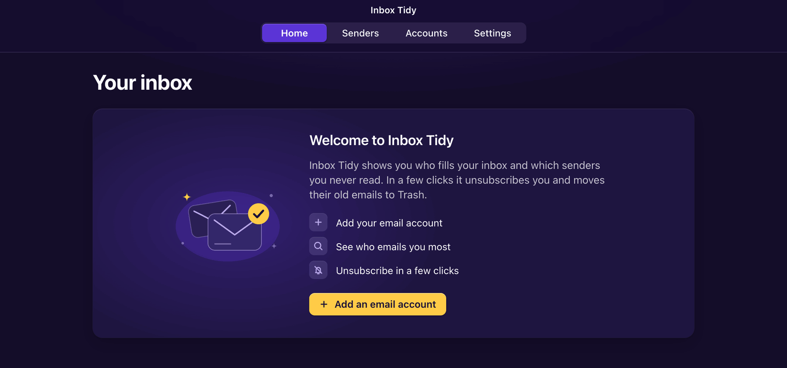
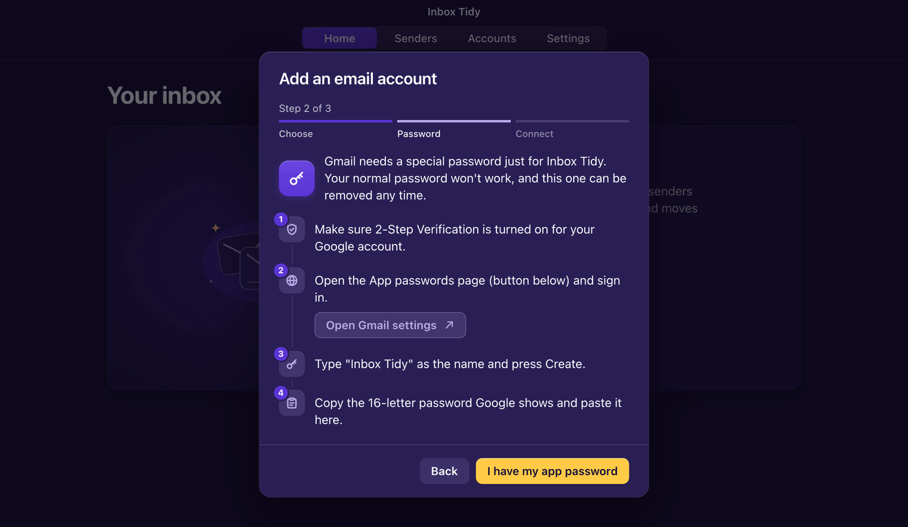
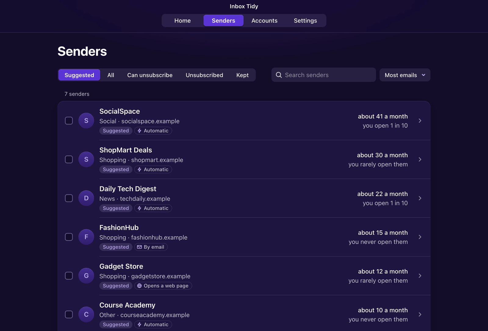

<p align="center">
  <picture>
    <source media="(prefers-color-scheme: dark)" srcset="assets/brand/logo-dark.svg">
    
  </picture>
</p>

<p align="center">
  <strong>See who fills your inbox, unsubscribe in a few clicks, and clear out years of old email. It's a small Mac app, and your mail stays on your Mac.</strong>
</p>

<p align="center">
  
  
  
  
</p>

<p align="center">
  
</p>

## What it does

Inbox Tidy is a personal macOS app that you open by double-clicking it, like any other app.

- **Shows who emails you most.** It reads your inbox's email headers from the last 12 months. For each sender it shows roughly how many emails a month they send and how many of them you open.
- **Recommends who to unsubscribe from.** Your own Claude Code CLI sorts your senders into categories such as shopping, news, bills, and personal, and suggests which ones to drop. If Claude Code isn't available it falls back to Codex, and without either it uses a simple built-in rule.
- **Unsubscribes for you.** It uses whatever method the sender offers. Some senders support automatic one-click unsubscribing. Others need an unsubscribe email, which Inbox Tidy sends from your account. If a sender only has a web page, Inbox Tidy opens it in your browser.
- **Moves old email to Trash.** You can trash all of a sender's emails, or only the ones older than 30 days, with an option to keep unread ones. They go to your provider's Trash, so you can still get them back.
- **Shows what you've achieved.** The home screen counts the senders you've left, the emails you'll no longer get each month, and the emails you've cleared.

Nothing is unsubscribed or moved without your confirmation. Each action opens a sheet that lists exactly what will happen.

It works with **Gmail, iCloud Mail, Yahoo Mail, Rediffmail Pro**, and any other provider that offers IMAP. Free `@rediffmail.com` accounts are not supported, because they don't offer IMAP.

<table>
  <tr>
    <td width="50%"><br><sub>First launch</sub></td>
    <td width="50%"><br><sub>Adding a Gmail account</sub></td>
  </tr>
  <tr>
    <td width="50%"><br><sub>Suggested senders to unsubscribe from</sub></td>
    <td width="50%"><br><sub>Every action is confirmed first</sub></td>
  </tr>
</table>

<sub>The screenshots use a local test mail server with made-up senders.</sub>

## Privacy: what leaves your Mac

- **Only headers, only your inbox.** Inbox Tidy reads the sender, subject, date, read or unread status, and unsubscribe headers of emails in your inbox from the last 12 months. You can change that to 3, 6, or 24 months. It never downloads email bodies or attachments. The inbox is opened read-only, so scanning never marks anything as read.
- **Your data stays on your Mac.** The header data is kept in a local database at `~/Library/Application Support/Inbox Tidy/`. There are no accounts, servers, analytics, or tracking.
- **Your passwords stay in the macOS Keychain.** Each account's app password is saved in your login Keychain under the name "Inbox Tidy". It is never written to the database, the logs, or any file. Removing an account in the app deletes its Keychain item.
- **The AI sees only this, for each sender:**
  - the display name, email address, and domain
  - roughly how many emails a month they send, and what share of them you open
  - whether they offer a way to unsubscribe
  - up to five recent subject lines, cut to 100 characters each

  It never sees email bodies, your own email address, or your passwords. Subject lines can contain personal details, such as your name or an order number, so keep that in mind. The request goes through the `claude` (or `codex`) CLI that you already use and are signed in to, with its tools turned off and in an empty temporary folder. Its answers are checked against a fixed list of categories before they're used. The terms of your Claude or ChatGPT plan apply to these requests.
- **Connections are limited.** At runtime Inbox Tidy connects only to your mail providers over encrypted connections, to the AI through your own CLI, and to the unsubscribe links of the senders you choose.

## Requirements

- A Mac running **macOS 13 Ventura or later**. It has been tested on Apple Silicon; Intel Macs should build too but haven't been tried.
- About 3 GB of free space for Apple's Command Line Tools (a one-time install). Inbox Tidy itself takes about 64 MB.
- **[Bun](https://bun.sh) 1.3 or later**, used to build the app.
- **Recommended:** [Claude Code](https://docs.anthropic.com/en/docs/claude-code/setup) signed in to your Claude account, or the [Codex CLI](https://developers.openai.com/codex/cli) signed in to ChatGPT. Without either, Inbox Tidy still works but its suggestions are simpler.
- For each email account, an **app password**. See [First use](#first-use-connect-your-email).

## Install

There are no ready-made downloads yet, so you build the app on your own Mac. It takes about ten minutes, mostly waiting. You'll paste a few commands into Terminal. Press Return after each one and wait for it to finish before the next.

> [!TIP]
> If you use Claude Code or Codex, it can do these steps for you. See [Install with an AI agent](docs/INSTALL_WITH_AN_AGENT.md).

**1. Open Terminal.** Press <kbd>⌘</kbd> <kbd>Space</kbd>, type `Terminal`, and press Return.

**2. Install Apple's Command Line Tools.** These give your Mac the compiler that builds the app's window.

```sh
xcode-select --install
```

A window asks you to install the tools. Click **Install**, accept the licence, and wait for it to finish. If Terminal says they are "already installed", you can skip this step.

**3. Install Bun.** Bun builds the rest of the app.

```sh
curl -fsSL https://bun.sh/install | bash
```

When it finishes, **quit Terminal (<kbd>⌘</kbd> <kbd>Q</kbd>) and open it again** so it can find Bun. Check that it worked:

```sh
bun --version
```

You should see a number such as `1.3.2`.

**4. Download Inbox Tidy.** This copies the source code into a folder called `inbox-tidy` in your home folder, then moves Terminal into that folder.

```sh
git clone https://github.com/siddnikh/inbox-tidy.git ~/inbox-tidy
cd ~/inbox-tidy
```

**5. Install what it needs.** This downloads the app's building blocks into that folder. Nothing else on your Mac changes.

```sh
make install
```

**6. Build the app and put it in Applications.** This takes a minute or two. When it's done you'll see `Installed /Applications/Inbox Tidy.app`.

```sh
make install-app
```

**7. Open Inbox Tidy** from Launchpad, Spotlight, or your Applications folder. You should see "Welcome to Inbox Tidy".

### Set up the AI helper (recommended)

Inbox Tidy uses the Claude Code CLI from your Claude subscription, and falls back to Codex from your ChatGPT subscription. Install at least one by following its official guide ([Claude Code](https://docs.anthropic.com/en/docs/claude-code/setup), [Codex](https://developers.openai.com/codex/cli)). Then run it once in Terminal and sign in:

```sh
claude
```

Type `/exit` when you're signed in. Then, in Inbox Tidy, open **Settings** and press **Test the AI helper**. You can also choose there whether to use Claude, Codex, or both.

## First use: connect your email

Inbox Tidy signs in with an **app password**. That's a separate password that you create for one app and can delete at any time. Your normal password won't work. In Inbox Tidy, press **Add an email account**, pick your provider, and follow the steps it shows. They're summarised here:

| Provider | What to do |
| --- | --- |
| **Gmail** | Turn on [2-Step Verification](https://myaccount.google.com/signinoptions/twosv) first, because Google only offers app passwords with it on. Then open [App passwords](https://myaccount.google.com/apppasswords), type "Inbox Tidy" as the name, press **Create**, and copy the 16-letter password. Work or school Google accounts may have app passwords turned off by their administrator. |
| **iCloud Mail** | Two-factor authentication must be on. Sign in at [account.apple.com](https://account.apple.com/account/manage), choose **Sign-In and Security**, then **App-Specific Passwords**. Press **Generate**, type "Inbox Tidy", and copy the password. |
| **Yahoo Mail** | Open [Account Security](https://login.yahoo.com/account/security), choose **Generate app password** (it may be under "External connections"), type "Inbox Tidy", and copy the password. |
| **Rediffmail Pro** | Ask your Rediffmail Pro administrator to turn on IMAP access (Admin, then Other Services, then Complete Mail Sync). Then use your normal Rediffmail Pro address and password. Free `@rediffmail.com` accounts are not supported. |
| **Other** | Find your provider's IMAP and SMTP server settings on its help pages. Create an app password if it offers them. Encrypted connections are required. |

Paste the app password into Inbox Tidy and press **Connect**. Inbox Tidy checks it, saves it to your Keychain, and starts reading your inbox. A large inbox takes a minute or two. If macOS asks whether Inbox Tidy may use your Keychain, choose **Always Allow**.

Then:

1. Open **Senders** to see who emails you most. **Suggested** lists the senders Inbox Tidy recommends dropping. Click a sender to see why.
2. Tick the senders you want to leave and press **Unsubscribe from N**. Tick **Also move their emails to Trash** if you want them gone too. Check the list, then confirm.
3. Press **Keep** on any sender you want to hear from, and it won't be suggested again.
4. Come back to **Home** to see your progress. Press **Scan again** now and then to pick up new mail.

## Update

Open Terminal and run:

```sh
cd ~/inbox-tidy
git pull
make install
make install-app
```

`make install-app` quits Inbox Tidy if it's open and replaces the old app. Your accounts and history are kept. After an update, macOS may ask about the Keychain again. Choose **Always Allow**.

## Uninstall

1. In Inbox Tidy, open **Accounts** and **Remove** each account. This deletes their Keychain items. Then quit the app.
2. In Terminal, delete the app, its data, its logs, and the source folder:

   ```sh
   rm -rf "/Applications/Inbox Tidy.app"
   rm -rf "$HOME/Library/Application Support/Inbox Tidy"
   rm -rf "$HOME/Library/Logs/Inbox Tidy"
   rm -rf "$HOME/Library/Caches/com.siddnikh.inboxtidy" "$HOME/Library/WebKit/com.siddnikh.inboxtidy"
   rm -f "$HOME/Library/Preferences/com.siddnikh.inboxtidy.plist"
   rm -rf ~/inbox-tidy
   ```

3. If you skipped step 1, remove any leftover passwords from the Keychain. This deletes only items saved by Inbox Tidy, and repeats until none are left:

   ```sh
   while security delete-generic-password -s "Inbox Tidy" >/dev/null 2>&1; do :; done
   ```

   You can also open **Keychain Access**, search for "Inbox Tidy", and delete the items.
4. Optionally, delete the app passwords on your provider's page (linked above). This makes sure they can't be used again.

Your emails are not affected. Anything Inbox Tidy moved to Trash stays in your provider's Trash until the provider empties it.

## Troubleshooting

Inbox Tidy writes a log to `~/Library/Logs/Inbox Tidy/core.log`. To open it, run `open ~/Library/Logs/Inbox\ Tidy/core.log` in Terminal. The log never contains your passwords.

| Problem | What to do |
| --- | --- |
| `bun: command not found` | Quit and reopen Terminal after installing Bun. If it still fails, run the Bun install command again. |
| `make: command not found`, `xcrun: error`, or `clang` errors | The Command Line Tools are missing or broken. Run `xcode-select --install`. If that says they're installed but `clang` still fails, run `sudo rm -rf /Library/Developer/CommandLineTools` and install them again. |
| `this SDK is not supported by the compiler` (Swift) | Inbox Tidy doesn't use Swift, so you can ignore this message. If `clang` itself fails, reinstall the Command Line Tools as described above. |
| "Inbox Tidy stopped working in the background" | Read the log above. Quitting and reopening the app usually helps. |
| Gmail says the password was refused, or "Application-specific password required" | Use an app password, not your normal Google password. If the App passwords page says the setting isn't available, turn on 2-Step Verification first. Work and school accounts may not allow app passwords. |
| iCloud or Yahoo refuses the password | Create a new app password and paste it without spaces. Make sure two-factor authentication is on. |
| "Couldn't reach …" | Check your internet connection and try again. Some work networks and VPNs block mail connections. |
| A Keychain prompt appears after updating | Each build is signed separately on your Mac, so macOS asks again. Choose **Always Allow**. |
| The AI helper shows as unavailable, or its test fails | Run `claude` (or `codex`) once in Terminal and sign in. If it works in Terminal but not in the app, check that `zsh -ilc 'command -v claude'` prints a path. Inbox Tidy finds the CLI through your login shell. |
| Suggestions say "Sorted without the AI helper" | The AI wasn't reachable during that scan. Fix the AI helper, then press **Scan again**. |
| Rediffmail won't connect | Only Rediffmail Pro with IMAP turned on by its administrator works. Free Rediffmail is not supported. |
| macOS says the app "can't be opened" | That only happens if the app was copied from another Mac. Build it on your own Mac with the steps above. Or Control-click the app, choose **Open**, and confirm. |

## How it works

Inbox Tidy is one app bundle containing two programs:

```text
Inbox Tidy.app
├─ Contents/MacOS/Inbox Tidy              native window (Objective-C, Cocoa + WKWebView)
└─ Contents/Resources/Inbox Tidy Helper   the core: TypeScript compiled with Bun into one binary
        │
        ├─ serves the UI (Preact) and a JSON API on 127.0.0.1, behind a per-launch session cookie
        ├─ SQLite:   ~/Library/Application Support/Inbox Tidy/inbox-tidy.sqlite (headers only)
        ├─ Keychain: service "Inbox Tidy", one item per account (Bun.secrets)
        ├─ IMAP (imapflow) and SMTP (nodemailer) over TLS to your providers
        └─ `claude -p` or `codex exec` child processes, with tools disabled, for sender sorting
```

- The window starts the core, reads the local address it prints, and loads it. Links to anywhere else open in your browser. Quitting the window stops the core.
- Scanning fetches envelopes, flags, and the `List-Unsubscribe` headers in batches, and later scans are incremental. Unsubscribing tries [RFC 8058](https://www.rfc-editor.org/rfc/rfc8058) one-click first, then a `mailto:` email, then the web page. Trash means an IMAP `MOVE` to the provider's `\Trash` folder. Nothing is ever permanently deleted.
- The build is ad-hoc signed on your Mac (`codesign --sign -`). It isn't notarised, and there are no prebuilt releases.

The API contract between the UI and the core is [`src/shared/api.ts`](src/shared/api.ts). The full technical notes are in [`ctx/TECH.md`](ctx/TECH.md), the design system is in [`ctx/DESIGN.md`](ctx/DESIGN.md), and feature status is in [`ctx/FEATURES.md`](ctx/FEATURES.md).

## Development

You need the same tools as above, plus [Colima](https://github.com/abiosoft/colima) and Docker for the local test mail server (`brew install colima docker docker-compose && colima start`). Development and tests never touch a real mailbox. They use a [GreenMail](https://greenmail-mail-test.github.io/greenmail/) server on `127.0.0.1` and a separate Keychain service.

| Task | Command |
| --- | --- |
| Install dependencies | `make install` |
| Start, stop, or reset the test mail server | `make infra-up`, `make infra-down`, `make infra-reset` |
| Run the app with live reload (data in `.local/dev-data`) | `make dev` |
| Lint, typecheck, and unit tests | `make check` |
| Integration tests against the test mail server | `make test-integration` |
| Format | `make format` |
| Build `dist/Inbox Tidy.app` | `make build` |
| Build and install to `/Applications` | `make install-app` |
| Everything | `make qa` |

The project uses Bun only, with no npm, pnpm, or Yarn. Contributor and coding-agent rules are in [`AGENTS.md`](AGENTS.md), and project knowledge lives in [`ctx/`](ctx/).

## Licence

No licence has been granted yet. The source is published for reference, and **all rights are reserved** by the author. You may not copy, modify, or redistribute it without permission. A licence may be chosen later.

The wordmark in the logo uses Satoshi by the Indian Type Foundry, converted to outlines (see [`assets/brand/README.md`](assets/brand/README.md)).
