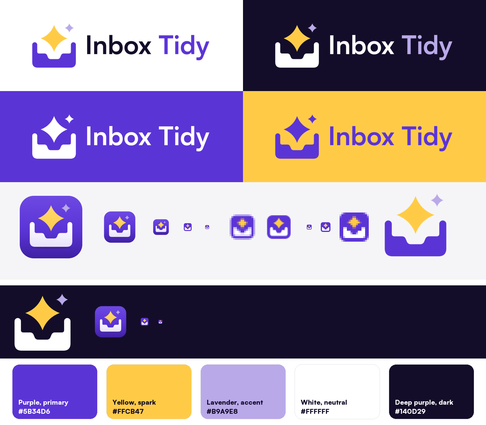

# Inbox Tidy brand

The mark is an empty inbox tray with a yellow spark rising out of it: the inbox is clear, and it shines. A tray instead of an envelope keeps the icon distinct from Mail in the Dock and still reads at 16 px.

## Files

| File | What it is | Use it on |
| --- | --- | --- |
| `logo.svg`, `logo.png` | Primary lockup: mark and "Inbox Tidy" wordmark | Light backgrounds |
| `logo-dark.svg`, `logo-dark.png` | Primary lockup with a white tray and wordmark | Dark backgrounds |
| `logo-white.svg`, `logo-white.png` | One-colour white lockup | Purple, dark, or photo backgrounds |
| `logo-purple.svg`, `logo-purple.png` | One-colour purple lockup | White or yellow backgrounds, single-ink print |
| `mark.svg`, `mark.png` | Standalone mark, no tile | Light backgrounds, next to text that already names the app |
| `mark-dark.svg`, `mark-dark.png` | Standalone mark with a white tray | Dark backgrounds |
| `mark-white.svg`, `mark-purple.svg` | One-colour marks | Watermarks, stamps, single-ink print |
| `submark.svg` | Simplified tile drawn on a 16 px grid (thicker walls, no glint) | Favicons, avatars, anything under 64 px |
| `favicon.ico`, `favicon-16.png`, `favicon-32.png` | Favicon set (the ICO holds 16, 32, and 48) | Browser tabs |
| `apple-touch-icon.png` | 180 × 180 submark | Home screen bookmarks |
| `app-icon.png` | The macOS app icon at 1024 × 1024 | README headers, release notes |
| `preview.png` | Every lockup on each palette colour, with the icon at 1024 to 16 px | Review |

Lockup and mark PNGs are transparent and 1600 px (lockups) or 1024 px (marks) wide. The SVGs are the masters: real paths, the wordmark converted to outlines, and a `viewBox` with no fixed size.

The app icon itself lives in `shell/icon/AppIcon.svg` (1024 canvas, 824 px tile, 185 px corners) with `shell/icon/AppIcon-small.svg` for the 16 and 32 px slots. Rebuild `shell/AppIcon.icns` with `bun scripts/build-icon.ts`.

## Palette

| Role | Colour | Hex | Use |
| --- | --- | --- | --- |
| Primary | Purple | `#5B34D6` | The tray, the app tile, "Tidy" on light backgrounds. About 30% of a branded surface |
| Accent | Yellow | `#FFCB47` | The spark only. About 5% |
| Accent (soft) | Lavender | `#B9A9E8` | The small glint, "Tidy" on dark backgrounds. About 5% |
| Neutral | White | `#FFFFFF` | Backgrounds, the tray on purple or dark. About 50% |
| Dark | Deep purple | `#140D29` | "Inbox" on light backgrounds, dark surfaces. About 10% |

The app tile's gradient runs from `#6D49E2` to `#3F21A3` around the brand purple; outside the icon, use the flat hexes above.

Contrast (WCAG): purple on white 7.2:1, deep purple on white 18.8:1, lavender on deep purple 8.9:1, yellow on deep purple 12.4:1, purple on yellow 4.8:1. Yellow on white is only 1.5:1, so never set text in yellow on a light background.

## Usage

- Clear space: keep at least the width of the small lavender glint free on every side of the logo or mark.
- Minimum size: the lockup at 120 px (25 mm) wide, the mark at 24 px. Below that, use `submark.svg` or the favicons.
- Don't stretch, rotate, recolour outside the palette, add effects, or move the spark.

The wordmark is set in Satoshi Bold by the Indian Type Foundry (free for commercial use under the Fontshare licence), converted to outlines, so no font is needed to use these files.
